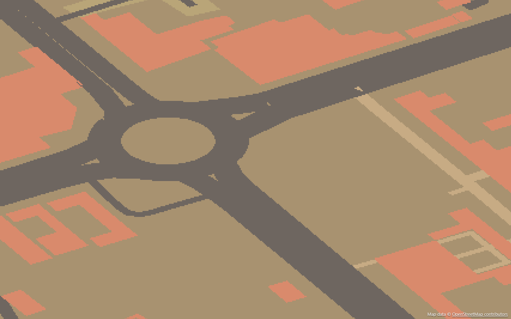

# PixelJaipur

A hand-built, living isometric pixel diorama of Jaipur's walled **Pink City**, made with three.js. It starts with one block around Hawa Mahal and Badi Chaupar and grows outward phase by phase.



Real 3D geometry is rendered through a 2:1 dimetric orthographic camera into a low-resolution target and scaled up with nearest-neighbour filtering. You get a pixel-art look while lighting, shadows and the day cycle stay real.

## Run it

```sh
npm install
npm run dev        # http://localhost:5173
npm test           # unit tests
npm run shots      # headless screenshots -> tests/shots/
npm run build      # production build -> dist/
uv run scripts/fetch_osm.py   # rebuild map data (needs uv)
```

Controls: drag to pan, mouse wheel to zoom (integer steps), **Q / E** to rotate.
URL options: `?mpp=0.5&zoom=3&rot=0&x=0&y=80`.

## Status

- [x] Phase 0: scaffold, palette, pixel camera, OSM footprints
- [ ] Phase 1: the Hawa Mahal slice (shop-houses, Hawa Mahal, bazaar, v0.1 online)
- [ ] Phase 2: make it alive (day cycle, traffic, sound)
- [ ] Phase 3: the whole walled city
- [ ] Phase 4: forts, stories, launch

The full plan is in [docs/PLAN.md](docs/PLAN.md), and decisions are logged in [docs/DECISIONS.md](docs/DECISIONS.md).

## Credits and licences

- Code: [MIT](LICENSE)
- Map data: © [OpenStreetMap contributors](https://www.openstreetmap.org/copyright), ODbL
- Asset sources and licences: [public/assets/LICENSES.md](public/assets/LICENSES.md)
